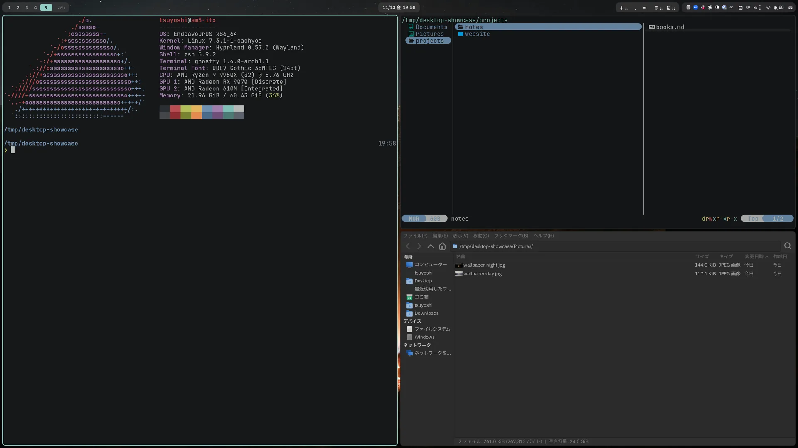
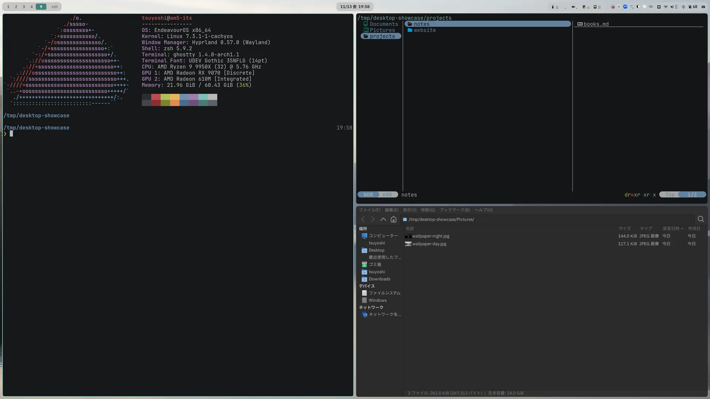
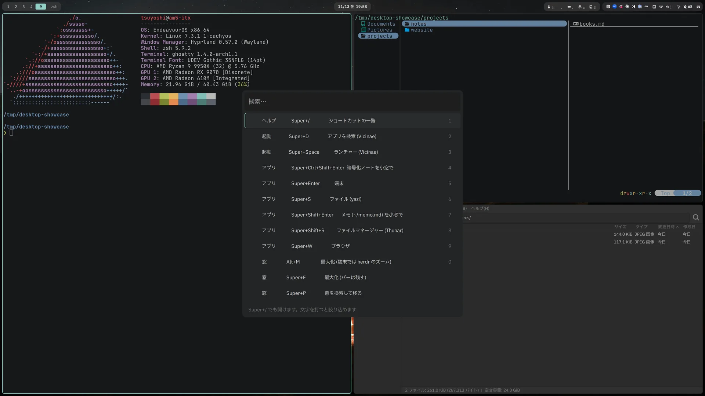
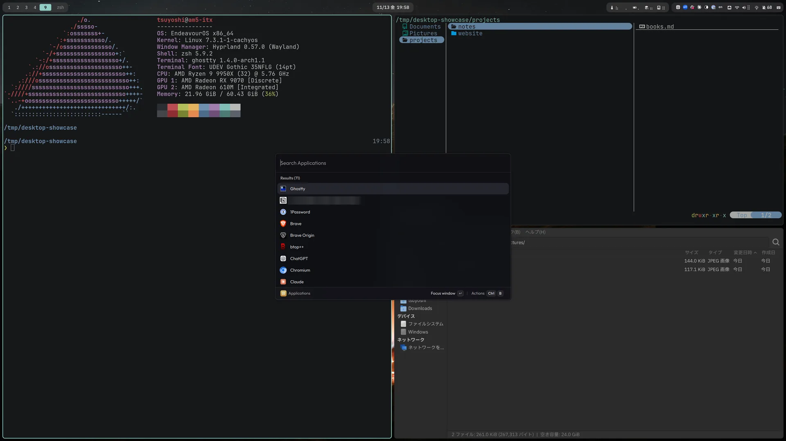

# dotfiles

> **Chezmoi-managed dotfiles for Hyprland / Wayland on Arch Linux** (CachyOS & EndeavourOS) + macOS.
> Single source across 3 machines via OS/hostname templating. Zsh + Starship, Neovim, Ghostty + herdr, fcitx5, waybar.
> *Detailed notes below are in Japanese.*

個人的な設定ファイルを [chezmoi](https://www.chezmoi.io/) で管理するリポジトリです。
**3台のマシン (macOS 1台 + Arch系 Linux 2台) を単一ソースで管理**しており、
OS / ホスト名によるテンプレート分岐が中核機構です。Linux は主に CachyOS
(Archベース) 向けで、EndeavourOS でもそのまま利用可能 (いずれも `ID_LIKE=arch`)。

## 見た目

Hyprland (am5-itx、2026-11)。端末は Ghostty、ファイラーは yazi と Thunar。配色はダークモードの「エレベーション」(背景に白 5/8/11% を重ねた面で高さを示す)。
waybar の島は壁紙に合わせて色を帯び、明るい壁紙では明るい島に反転する (`waybar-wallpaper-tint`、壁紙は darkman で昼と夜に切り替わる)。
画像は `desktop-showcase` で空のワークスペースにデモの窓だけを並べて撮ったもの。

| 夜 | 昼 (バーが明るい島に反転) |
|---|---|
|  |  |
|  |  |

## マシン構成

| ホスト | OS / WM | テーマ (色分離) | 分岐条件 |
|---|---|---|---|
| mac (M1) | macOS | Gruvbox Material (緑) | `eq .chezmoi.os "darwin"` |
| am5-itx | Arch系 (CachyOS) / Hyprland | Hybrid (青) | デフォルト (`else`) |
| fp7-e14 | Arch系 / Hyprland (常時稼働) | Catppuccin Mocha (紫) | `eq .chezmoi.hostname "fp7-e14"` |

3台のテーマは CIEDE2000 で色相の被りが無いことを確認して選定
(どのマシンの画面かが色で即座に分かる)。パレットは `home/.chezmoidata/data.yaml` に集約。

## セットアップ

前提: テンプレートが `onepasswordRead` を使うため **1Password CLI (`op`) の
インストールとサインインが必要** (無いと初回 apply がレンダリングで失敗します)。

```bash
# chezmoi のインストール
paru -S chezmoi          # Arch/EndeavourOS
brew install chezmoi     # macOS

# 1Password CLI にサインインしてから
chezmoi init --apply nagamine-git
```

- Linux では初回の apply で `home/.chezmoiscripts/linux/` のスクリプトが、`system/pkglist.txt` のパッケージ・システム設定 (`system/etc`)・壁紙を入れます (sudo を使う)
- 開発時は `prek install` を推奨 (pre-commit 互換。gitleaks / shellcheck 等がコミット時に走る)

### 構成

`.chezmoiroot` で、ホームに配るもの (`home/`) とリポジトリの道具を分けている。

| 場所 | 中身 |
|---|---|
| `home/` | chezmoi のソース (`dot_*`、`private_dot_*`、`.chezmoidata`、`.chezmoiignore`、`.chezmoiremove`) |
| `home/.chezmoiscripts/` | 実行スクリプト。`linux/` の 3 つは中身を OS の条件で囲み、Mac では空になって走らない |
| `system/` | ホームの外へ入れるもの: `etc/` (keyd・systemd・scx など)、`pkglist.txt`、`wolow/` |
| `tests/` `docs/` `.github/` | テスト・文書・CI (ホームには配らない) |

### 更新

```bash
chezmoi apply -v
```

`home/.chezmoiscripts/linux/` のスクリプトは、関係するファイルが変わったときだけ再実行される。

| スクリプト | 再実行の条件 | 中身 |
|---|---|---|
| `run_onchange_before_10-packages` | `system/pkglist.txt` が変わったとき | 入っていないパッケージだけを入れる (更新は普段の `paru -Syu`) |
| `run_onchange_after_20-system` | `system/etc`・`system/wolow` が変わったとき | /etc への設定、サービスの有効化、firewalld、Tailscale |
| `run_onchange_after_30-wallpaper` | スクリプト自体が変わったとき | 昼と夜の壁紙の取得、waybar の島の色 |

`system/pkglist.txt` から外したパッケージは自動では消えない。不要なら `paru -Rns <パッケージ>` で消す。

### AIの共通回答形式

回答形式の正本は `home/dot_agents/AGENTS.md` の「Codex のみ」節です。
Claude Code と Codex の共通指示と同じファイルで、Linux と macOS で `~/.agents/AGENTS.md` と
`~/.codex/AGENTS.md` に展開します (Claude Code は `~/.claude/CLAUDE.md` から読み込みます)。
このファイルはOS・ホスト別の除外対象ではありません。

既存のchezmoi環境では、sourceを更新して対象だけ適用します。
作業中の変更があれば、先に保存してください。

```bash
git -C "$(chezmoi source-path)" pull --ff-only origin main
chezmoi diff ~/.codex/AGENTS.md
chezmoi apply --dry-run --verbose ~/.codex/AGENTS.md
chezmoi apply --verbose ~/.codex/AGENTS.md
```

新規環境は上記セットアップ後に反映されます。
適用後、新しいCodexセッションを開始してください。
`CODEX_HOME` 指定時は、その配下へ指示を配置します。
`AGENTS.override.md` とプロジェクト指示は優先されます。

ChatGPTとdotsの設定はchezmoiから自動同期されません。
`回答形式` の5項目を、同じアカウントの指示にも記録します。
別アカウントではカスタム指示とdotsに再登録してください。

参考: [OpenAI公式の指示読込仕様](https://learn.chatgpt.com/docs/agent-configuration/agents-md)

## 構成ハイライト

- **シェル**: zsh + sheldon + starship (2行プロンプト、`starship.toml.tmpl` で3台配色分岐)
- **ターミナル**: Ghostty (UDEV Gothic 35NFLG / リガチャ無効 / カーソル点滅無効)
- **herdr**: 3台とも Ghostty の上で使う多重化ツール。prefix は tmux と同じ **`C-t`**。
  zsh の `hgh` / `hd` / `hm` / `ha` / `hs` で space を開く。`hd` は選択画面を挟まず、カレントディレクトリ (引数があれば指定先) を開く。Claude Code の完了と承認待ちは herdr がデスクトップに通知する
- **tmux**: ssh 先など herdr の無い場面用に残している。prefix は **`C-t`**。TPM (tmux-power / resurrect / continuum / fzf / tilit)。
  pane 数で main-vertical (≤3) ⇔ tiled (≥4) を自動切替 (`M-Enter` でトグル、`M-m` で zoom)
- **Neovim**: leader は **Space**。VSCode 相当の操作系 + 認知科学ベースの UI 設定
  (詳細は下表)。キーの学習は nvim 内で **`:Tutor chezmoi-keys`**

| 機能 | プラグイン | キー |
|---|---|---|
| ファイルツリー | neo-tree | `C-n` |
| ファイル/全文検索 | telescope | `C-p` / `C-f` |
| ソース管理 (diff) | diffview | `Space gg` |
| パンくず | dropbar | (常時表示) |
| 補完 | blink.cmp | `Tab` / `CR` |
| ラベルジャンプ | flash | `s` + 2文字 |
| 問題パネル | trouble | `Space xx` |
| Git ハンク操作 | gitsigns | `]c` `[c` `Space gs` |

## Wolow Companion (Linux のみ)

iPhone の Wolow アプリからの遠隔電源制御 daemon。
`50-wolow-companion.rules` (polkit) / `install.sh` / `uninstall.sh` が部品で、
`home/.chezmoiscripts/linux/run_onchange_after_20-system.sh.tmpl` から自動導入されます (macOS では走らない)。

バイナリ `wolow-companion` は **git 管理外** (2026-07 にバイナリ直コミットを廃止)。
導入済みマシンは `/usr/local/bin/wolow-companion` の既存コピーで動き続けます。
新規マシンでは既存機からバイナリを取得してから apply:

```bash
scp am5-itx:/usr/local/bin/wolow-companion ~/wolow-companion && chezmoi apply
```

## マシン追加チェックリスト

1. `home/.chezmoidata/data.yaml` に配色パレットを追加 (既存3台と CIEDE2000 で色相分離を確認)
2. hostname 分岐を持つファイルに分岐を追加:
   `home/private_dot_config/nvim/init.lua.tmpl` / `home/dot_tmux.conf.tmpl` /
   `home/private_dot_config/starship.toml.tmpl` / `home/private_dot_config/hypr/hyprland.lua.tmpl` /
   `home/private_dot_ssh/config.tmpl` / `run_onchange_fp7-sleep-mask.sh.tmpl` (該当時)
3. `system/pkglist.txt` と `home/.chezmoiignore` の OS 分岐を確認
4. `chezmoi apply --dry-run -v` で差分を確認してから適用

## 復元手順 (新規機・被災機)

1. chezmoi と 1Password CLI を導入し `op` にサインイン
2. `chezmoi init --apply nagamine-git`
3. Linux: 再ログイン (Hyprland / systemd user unit 反映)。tmux は初回起動時に
   TPM がプラグインを自動導入
4. `~/.config/zeed/claude-budget.json` 等の mutable state は chezmoi 管理外
   (必要なら旧機から手動コピー)

### claude-pace (Claude Max 残量計)

`~/.local/bin/claude-pace` は ccusage の active 5h block を読み、loop 司令塔が
配車数を動的調整するための JSON を 1 行出力します (要: jq, ccusage):

```bash
$ claude-pace
{"pct":33,"output_tokens":231220,"budget":700000,"recommend":"scale-up","block_end":"2026-06-11T18:00:00.000Z","remaining_min":184}
```

- `recommend`: scale-up (<60%) / hold (60-80%) / throttle (80-95%、軽作業のみ) / pause (>95%)
- 予算は `~/.config/zeed/claude-budget.json` の `output_budget_5h` (無ければ 700k output tokens / 5h)。
  limit hit 時に司令塔が実測 outputTokens を `hits` 配列へ追記して自動較正します
  (このファイルは司令塔が書き換える mutable state なので chezmoi 管理外)
- Cockpit 可視化は新 endpoint 不要 — 司令塔が wake ごとに
  `https://telemetry.zeed.run/v1/agent-status` へ POST します
  (`agent_id: local:claude-usage`, `kind: background`, `state: running`,
  detail 例「窓 38% (out 270k/700k) · scale-up」)。詳細はスクリプト先頭のコメント参照。
